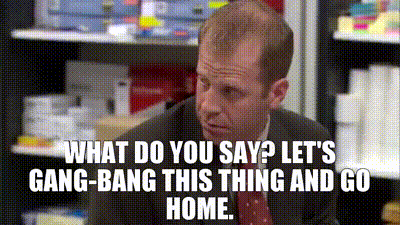
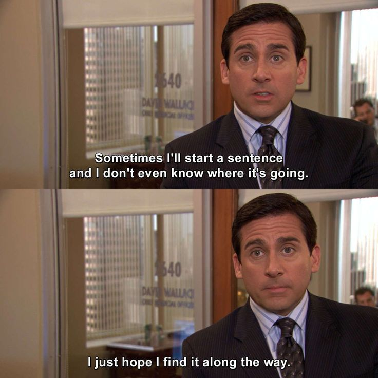

# gangbang



A Claude Code workflow that takes a request (a feature, a bug, a refactor, a
small change) from "here's what I want" to "done, and here's the proof". It
profiles the project, triages the request, designs or diagnoses where needed,
then loops implement → test → review on its own until the review is clean.
Only then does it show you the work, and you accept it or send it back.

You start it with `/gangbang`. The model never starts it on its own.

This file is a user guide. The skills are the source of truth: the flow,
routes, state file and acceptance rules are in
[`skills/gangbang/SKILL.md`](skills/gangbang/SKILL.md), and each step's
details in its own `skills/gb-*/SKILL.md`. The steps are named after The
Office; [The steps](#the-steps) says which name does what.

## Quick start

```
/gangbang archived items should be hidden from the default list
```

You will be asked to:

1. allow (or decline) a project profile, the first time in a project
2. approve the triage: kind, route and acceptance criteria
3. choose who sets up the test environment, the first time in a project
4. approve the design (features) or the diagnosis (bugs)
5. allow a launch of the app, only if some criteria need a person to check them
6. accept the result, or say what's wrong

Between 4 and 6 it works on its own, unless it hits a service that's down
or a choice only you can make. Any step also stops when there's more than
one reasonable way and the project doesn't already answer which one; your
answers are recorded so you're never asked twice.

## Commands

| Command | What it does |
|---|---|
| `/gangbang <request>` | Starts new work. If an open state file looks like the same request, it asks whether to resume that one instead. |
| `/gangbang` | Lists this project's unfinished work and asks which one to resume. |
| `/gangbang resume <slug>` | Continues from the state file's `Next` step. On finished work, reopens it as a new round. |
| `/gangbang drop <slug>` | Abandons the work after confirming. Code changes stay. |
| `/gangbang clean` | Deletes finished state files after confirming. |

Each step is also its own skill, so you can run one on its own.

## How a request flows

```
gb-what-i-do-here-every-day      profile
gb-diversity-day             ✋  triage
gb-im-going-to-die               environment
route                        ✋  design or diagnosis (see below)

build loop, until clean:
  gb-dont-know-where-this-is-going   implement  <-----------+
  gb-how-the-turntables              test (area)            | findings or
  gb-how-dare-you                    review (what changed) -+ failures

final check                      full tests + review of everything
gb-fire-drill                    manual checks, if any
acceptance                   ✋
```

Each pass is kept fast: only the tests for the area the change touches,
and a review of what changed since the last review. Once the loop is
clean, the **final check** runs the full test suite and reviews everything
since the work started; anything it finds goes back into the loop. You
never get to acceptance without a clean final check, unless you
explicitly skip it, and then acceptance says so.

| Kind | Route |
|---|---|
| **Feature** | gb-would-an-idiot-do-that ✋ → build loop |
| **Bug** | gb-its-marijuana ✋ → build loop |
| **Refactor** | gb-how-the-turntables (pin current behaviour) → build loop |
| **Small change** | build loop |

gb-how-the-turntables and gb-how-dare-you run in fresh subagents, so they
judge the code, not the author's reasoning. Nothing in the repo changes
while they run.

## The steps

| | Step | What it does |
|---|---|---|
|  | `gb-what-i-do-here-every-day`<br>profile | Loads or writes `.claude/gangbang.md`, a map of the project every step works from |
|  | `gb-diversity-day`<br>triage | Reads the code the request touches; proposes kind, route and acceptance criteria |
|  | `gb-im-going-to-die`<br>environment | Checks what the tests need and gets it running, by you or by Claude with existing resources only |
|  | `gb-would-an-idiot-do-that`<br>design | Discusses a feature, writes its design doc and criteria |
|  | `gb-its-marijuana`<br>diagnose | Reproduces a bug as a failing test, finds the root cause, proposes fixes |
|  | `gb-dont-know-where-this-is-going`<br>implement | Builds what was approved, nothing more, the project's way |
|  | `gb-how-the-turntables`<br>test | A test per criterion on realistic data, checked to fail on the code before the change; runs the area's tests (in the loop) or everything (final check) |
|  | `gb-how-dare-you`<br>review | `/code-review` plus the project's conventions, on this work's changes only (what changed since the last review in the loop, everything at the final check); fix list or clean |
|  | `gb-fire-drill`<br>manual checks | With your permission, runs the app and checks screen criteria, with screenshots |

## Acceptance

You decide from proof, not from "I implemented it". Each criterion is ✅
(with a test, a screenshot or a command's output), 🔎 met by reading the
code (only where no test can prove it), ❌ not met, or ⚠️ changed. Each test
cited says what data it uses, why that data can really occur, and whether it
fails on the code before the change. If you send it back, it offers two or
three ways to fix it, and everything after that point runs again.

When you say it's done, the profile is updated, anything
gb-im-going-to-die started is offered for stopping, and you get a summary.
**It never commits, pushes or
opens a PR.**

## Files

`<project>` is the git root's path with every `/` replaced by `-`.

| File | Contents |
|---|---|
| `~/.claude/work/<project>/<slug>.md` | State: request, Start commit, kind, route, round, build pass, last reviewed snapshot, running step, `Next`, criteria, your decisions, a log |
| `~/.claude/work/<project>/<slug>/` | Screenshots; a temporary worktree for checking tests against the code before the change |
| `~/.claude/work/<project>/env.md` | Who sets up the environment, what the tests need, what worked |
| `<git root>/.claude/gangbang.md` | The project profile (only if you agreed; checked in) |
| design docs, mockups | Where the project keeps them |

The work's scope is everything changed since the `Start` commit, recorded
when the work begins. Review and acceptance look only at that.

## Limits

| Limit | What happens |
|---|---|
| **3 build passes** | If review still has findings after the third, it stops and shows you what keeps coming back. Passes from the final check count too. Scope you add along the way resets the count. |
| **3 rounds** | If acceptance fails in round 3, it stops and suggests going back to the design or diagnosis. |

## Requirements

- A git repository.
- The skills `gangbang` and `gb-*` in `~/.claude/skills/`.
- The built-in `code-review` skill, plus `run` or the browser skills for
  gb-fire-drill.
- Whatever the project's tests need; gb-im-going-to-die works this out per
  project.
